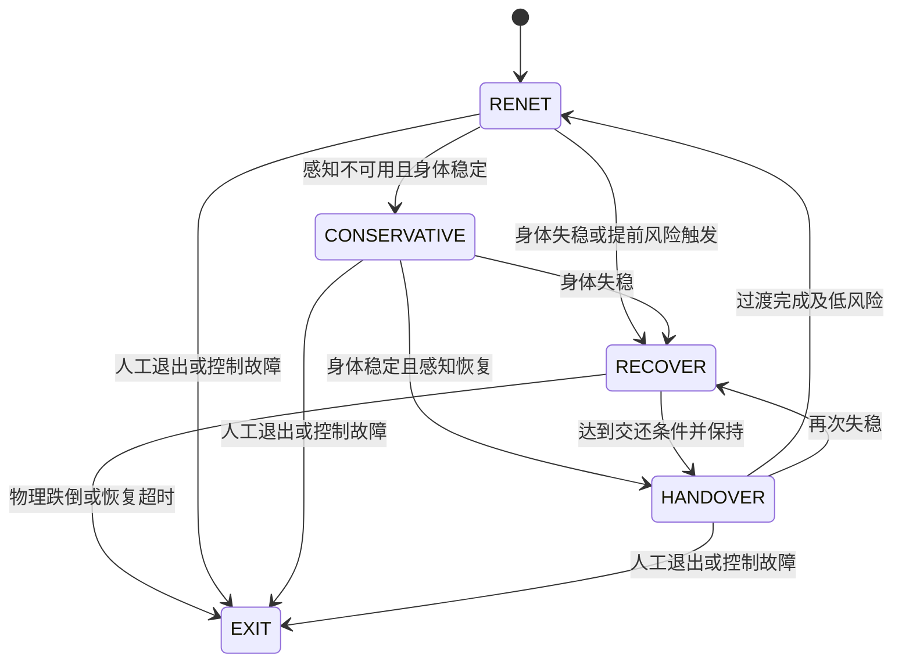

# 面向冻结 G1 RENet 的平衡恢复策略方案

日期：2026-10-11。状态：设计建议，尚未实现或训练。服务对象：`logs/g1_renet/2026-09-04_14-11-25/model_60000.pt` 对应的冻结部署策略。

## 1. 将想法定义为可验证的任务

建议新增任务名 `g1_balance_recovery`。它在行走失稳、尚有机会避免倒地的状态短时接管，允许纠正步、髋踝调整和手臂平衡，随后将控制交还给冻结 RENet。

核心目标：在受扰动或感知故障后的可恢复窗口内，避免物理跌倒，回到 RENet 能继续控制的状态，并完成交还后的持续行走。恢复阶段暂时降低任务速度要求，把平衡与可执行性放在优先位置。

建议第一版使用同一个本体平衡策略承担稳定站住和主动纠正两个用途，由监督状态机区分触发原因、恢复预算与退出条件。倒地起身单列为后续能力，其接触模式、失败定义和数据不同。

| 使用情形 | 建议行为 | 结束条件 |
|---|---|---|
| 身体稳定、感知不可用 | 降低速度命令，进入已训练的保守站稳行为 | 身体稳定且选定感知恢复可用 |
| 身体快速失稳、仍处于经验恢复范围 | 平衡策略接管，允许主动纠正 | 达到 RENet 交还区域，并通过持续条件 |
| 已倒地、超出验证范围或输入/控制故障 | 进入已验证的退出流程；第一版不自动承诺起身 | 人工或另一个已验证模块处理 |

感知不可用不能直接判成将要摔倒；预测风险高也不能证明新恢复策略一定能成功。

## 2. 当前仓库的可复用基础与差异

- [g1_recovery_cfg.py](../legged_lab/envs/g1/g1_recovery_cfg.py)：已有相同 G1_23CFG、23动作、0.25 scale、200Hz物理/50Hz策略、十帧历史、自碰撞及动作正则。
- [g1_recovery_env.py](../legged_lab/envs/g1/g1_recovery_env.py)：actor单帧75维，纯本体；动作有限性检查和关节目标soft-limit可复用。
- 现有任务平地、从 `recovery_candidates_v3` 动作轨迹采样；成功只判断pelvis高度达到默认高度的85%、torso up_z≥0.93并保持0.5s；尚无角速度/速度稳定和 RENet交还指标。
- 现有 AMP 是195维全身特征，专家是起身轨迹。它和 RENet 的50维AMP、近跌纠正动作不同，不能直接沿用为平衡恢复先验。
- [selector/runtime.py](../legged_lab/selector/runtime.py) 的 `both_unreliable` 合并两路风险高与两路感知不可用；目前只产生标志、保留LP/VP路由，没有第三个恢复动作。
- [selector/supplement.py](../legged_lab/selector/supplement.py) 的 `recovery` profile 指感知故障恢复阶段，不表示已经训练了机器人平衡恢复策略。
- [selector/collector.py](../legged_lab/selector/collector.py) 与 [snapshot.py](../legged_lab/selector/snapshot.py) 的反事实分支和重放检查可作为失稳状态采集基础。现有持久shard主要为特征/标签，不含足以重新建立动力学状态的完整物理快照。

建议新建环境/配置，复用经过核查的组件。现有g1_recovery对reward权重等有固定断言，直接改名或仅替换reset文件不能表达这个新任务。

## 3. 控制架构

冻结 RENet负责日常走路；已有selector负责LP/VP风险选择；新增balance policy负责平衡恢复；一个统一supervisor决定谁拥有目标输出权。

图中CONSERVATIVE与RECOVER可共用同一个本体平衡网络，状态机规定不同入口与交还权限。人工SELECT及C++故障处理优先于学习策略。

不要将动作接口的LP/VP `estimator_mode` 偷改成RECOVERY=2：需要独立controller mode/ownership标识，仍保留nominal estimator信息、epoch、sequence和目标时间戳。

## 4. 初版观测和动作

建议actor使用与现有recovery一致的75维单帧、10帧历史：

`gyro3 | projected_gravity3 | (q-q_default)23 | dq23 | executed_previous_action23`。

恢复阶段没有需要跟踪的用户速度命令，因此可不输入命令3维。从 RENet 的78维历史按每帧去掉command字段适配，不能对整个780向量随意截断。

actor第一版不依赖LP/VP图像，让它在感知故障时仍可工作。未知台阶、狭窄支撑和缺失落脚地面会限制纯本体策略的恢复范围，必须分地形测量；后续再考虑健康门控的局部感知。关节历史可反映支撑变化，但不等同于获得真实脚接触测量。

critic可使用仿真真实线速度、CoM/动量、脚接触/支撑、局部地面高度、摩擦及扰动等；reward可使用这些真值。真机supervisor和actor不能直接读取仿真特权量。当前ProprioPolicyInput没有真实根线速度、地面高度或脚接触字段，初版在线触发以IMU与关节历史为核心；可用估计量要另行验证。

输出23维动作，维持默认姿态、关节顺序、0.25 scale和部署PD增益：

`q_target = q_default + 0.25 * action`。

训练和部署共同采用同一有限值检查、关节限位和经过验证的目标变化约束；所有clip/限位/过渡都进入训练rollout。previous action记录实际执行目标对应的动作，例如 `(q_commanded-q_default)/0.25`，而非网络原始候选。

## 5. 训练数据：优先服务 RENet 的失稳分布

### 5.1 冻结基线并采集真实失稳轨迹

使用归档legacy builder加载model_60000，不用当前multi-head配置替代。记录基线hash、sensor/noise contract、动作限制、控制延迟及failure版本。

分别采集实际VP路径、LP路径及后续selector路径，覆盖前后/侧向/转弯/单支撑的推扰、滑移、命令突变、台阶接触和感知错误。按每个失败episode回溯多个失稳前时刻，记录距物理跌倒的时间，避免只存接触地面的最后一帧。

新增可持久化状态库，保存root pose/twist、q/dq、地形及材料参数、外力状态、控制目标、真实执行动作历史、传感器/故障阶段和足以重建延迟的状态。为交还测试同时保留nominal历史和质量状态。

PhysX接触warm-start不能完整公开保存；复用现有重放一致性检查，对重置后可比性进行审计。现有5×283 selector feature shard不能直接当作机器人物理状态reset文件。

### 5.2 分层采样与课程

初期混合稳定站立/正常行走状态、轻失稳状态、nominal难以纠正但仍可避免倒地的状态。稳定样本避免网络在普通状态过度动作。后续以完整闭环中新出现的失败状态持续补充库。

课程：平地轻推 → 多方向推扰与不同步态相位 → 滑移和命令突变 → 低台阶/坡面 → RENet部署地形与感知故障。扰动强度从同一条件下nominal仍能稳定逐步增加到出现可恢复失败；记录力、作用时间和冲量，避免只用没有持续时间的“推力大小”描述。

可直接在nominal rollout中切入恢复策略训练，以保留真实接触/控制历史。状态库reset用于并行和边界覆盖，不能完全代替连续接管rollout。单纯随机tilt/q初始化容易产生穿模或不真实接触，要做可行性筛选和真实扰动对照。

### 5.3 算法和先验

初版建议独立PPO＋非对称critic。先建立无AMP基线；如果有覆盖纠正步、髋踝平衡和摆臂的匹配专家数据，再比较AMP增益。现有行走AMP或起身AMP均不直接作为默认平衡约束，以免抑制必要的非周期纠正。

独立策略可从现有纯本体recovery架构复用组件；RENet共享actor依赖LP/VP latent，不能通过简单删感知输入转成本体策略。residual safety policy可作为后续对照，其对失效nominal动作和感知的依赖必须测量。

## 6. 奖励和成功条件

恢复奖励建议含四组：

1. 避免物理跌倒和关节/接触约束违规；明确头/躯干地面碰撞等失败事件，区别normal air-time和纠正步。
2. 增加稳定性：重力对齐、降低roll/pitch角速度、消除过量动量、保持与局部地面相适应的高度。
3. 回到nominal交还区域：目标姿态、速度/接触稳定，并在实际交还试验中保持低风险。
4. 适度动作变化、力矩/功率、自碰撞及耗时正则。

运动早期允许积极纠正，稳定后加强速度/动作收敛；过强的小动作/关节加速度惩罚可能压制救步。允许步行移动换取平衡，不要求恢复过程中锁定原地。对局部地形使用相对地面高度，不能拿平地绝对world z作为台阶上的通用目标。

Capture point/CoM支撑关系可作为critic和辅助reward，使用时承认简化模型对动态、多接触和台阶的局限，不能把“质心始终落在当前支撑多边形里”当成全部恢复的硬条件。

将两个指标分开：

- **物理恢复成功**：无物理跌倒、约束可接受，达到姿态/角速度/速度稳定并保持。
- **系统恢复成功**：物理恢复成功，完成handover，并由冻结 RENet继续控制一个测试窗口且不再次失稳。

建议仿真初始测试预算：恢复2～4s、稳定保持0.5～1s、handover后观察2～5s；这些只是实验起点。最重要的不是某个固定数值，而是同一预算下测量不同方案的闭环成功率。

训练可先优化单独物理恢复，再将真实handover纳入训练rollout。若使用handover terminal bonus，必须来自实际nominal continuation或另经验证的判别器，而非只用upright作为代理。

## 7. 接管判据、交还与可恢复范围

### 接管

第一版建议规则和预测组合：50Hz读IMU/关节历史，检测倾角与外倾趋势、角速度和支撑异常估计；selector的0.4/1s风险提供提前预警，区分“两路未来风险高”和“两路感知不可用”。selector的10Hz节奏不能独占紧急反应通道。

现有标签 `tilt>0.8rad`、`clearance<0.45m` 是失败标签定义，不能直接成为接管阈值。以反事实实验扫描接管时间/延迟，找出nominal不能自救但balance policy仍能成功的窗口；按假触发率、漏触发率、可挽救跌倒比例校准规则与模型。

原selector学习的是LP/VP未来失败风险，不能自动当成recovery成功概率。后续单独训练 `P(recovery→handover成功 | 可部署观测历史)`，估计当前恢复策略的经验范围，及handover后nominal未来失败风险。这些模型均依赖具体policy、地形、延迟和约束版本，升级后要重采/重标定。

### 交还

进入恢复后暂时衰减原速度命令；经过物理稳定保持、选定感知可用、nominal续控风险低、动作目标兼容条件后交还，再平滑恢复原用户命令。接管和交还使用不同门限与持续条件，避免反复跳变。

nominal和recovery历史在恢复过程中持续更新，previous action使用共同的真实执行动作。恢复接管要保留连续历史，不复用当前A启动策略时的清零历史/零动作seed流程。V1 actor为窗口MLP，不需单独长期hidden；nominal VP GRU也按窗口初始化。但selector自身的时序/模式信息在recovery轨迹上会产生分布外输入，不能未经扩展训练就信任其handover概率。

动作过渡从上一实际q目标出发。现有5步＝100ms过渡可能吞掉救步窗口：接管与交还分别测量适合的时长，连同推理/消息/低层延迟一起训练。平滑插值本身不保证两动作之间动态可行。

第一版明确统计未能恢复的状态和时间超限；无法保证任何将要跌倒的姿态都可救。已有静态阈值、风险sigmoid和return都不构成形式安全证明。

## 8. 如何证明它有价值

固定model_60000、同一失稳快照、同一故障/外力/随机化，对比：

| 方案 | 主要验证问题 |
|---|---|
| 原RENet VP | 当前部署基线 |
| LP/VP选择 | 单靠换感知分支是否足够 |
| 原RENet降命令至零 | 改善来自减速还是新动作能力 |
| 平地零速度站稳policy | 失稳库和真实交还训练是否必要 |
| 新balance policy＋真实supervisor＋handover | 完整闭环收益 |

已有g1_recovery若有对应checkpoint，可另作对照，不把“存在环境”当成“已有有效策略”。

报告：物理跌倒率、避免nominal跌倒的比例、系统恢复成功率、交还后再次失稳率、恢复耗时分布、假接管率、接管延迟、每米/每分钟接管次数、跟踪性能损失、目标跳变、约束违规和各地形分组结果。

成功率分母包含所有预定义测试初态，另外单列验证过的恢复范围，避免只展示成功个例。按episode/地形seed/故障event拆训练、验证、测试，不能把同一条倒地轨迹的相邻回溯帧拆入不同集合。使用配对测试及置信区间，保留未见扰动方向和幅值作OOD测试。

强烈建议加入oracle触发与真实触发对照、零延迟与真实延迟对照，以及去handover训练对照，以定位失败来自控制器、检测器还是交还。

## 9. 实现阶段和首版交付物

1. 定义物理失败、交还成功和版本contract，建立固定nominal baseline。
2. 连续rollout采失稳前状态与可重放状态库；保留episode/event分组。
3. 训练纯本体平衡策略，先验证单策略物理恢复和正常状态行为。
4. 仿真加入触发器、命令衰减、目标过渡和nominal continuation；按完整系统指标迭代。
5. MuJoCo验证相同动作限制/延迟/历史契约。
6. 部署接入统一目标仲裁与新controller状态，并验证时间戳/有限值/超时处理；再开展实机分阶段验证。

首版可审查交付物应包括：新任务cfg/env、失稳采集入口与manifest、恢复训练入口/checkpoint、独立model contract、闭环评估脚本和配对结果、supervisor仿真实现。当前这份文件仅完善方案，不建立这些实现。

部署优先复用现有C++ motor映射和PD，不允许两个Python节点同时竞争joint_target。policy_node现有三路输入齐全才推理的入口必须重构，让本体恢复不等待depth/elevation。C++目前target_age只是诊断、LowState也没有新鲜性门控，新增recovery不能补救Python进程退出或LowState本身失效；这些故障需在执行层处理。

## 10. 查证的研究依据与适用边界

检索路径：相关学术MCP未挂载；用公开检索发现并直接核查arXiv原论文与全文。下面仅给出与设计相关的原理，不套用论文数值到G1。

- [Recovery RL: Safe Reinforcement Learning with Learned Recovery Zones](https://arxiv.org/abs/2010.15920)，RA-L/ICRA 2021：将任务与恢复目标分配给不同策略，并学习风险区域；其机器人验证不是本项目G1近跌恢复，适合借鉴分工。
- [Safe Reinforcement Learning for Legged Locomotion](https://arxiv.org/abs/2203.02638)，2022：四足任务中采用trigger set与recovery policy，并将任务策略未来续控能力用于交还判断；支持把交还单列验证，不能直接复制其四足阈值。
- [Embedding Classical Balance Control Principles in Reinforcement Learning for Humanoid Recovery](https://arxiv.org/abs/2603.08619)，2026预印本：H1-2中用本体actor、balance-informed privileged critic与reward；证明该设计思路值得作为候选。其主要消融同时移除了多项组件，不能据此归因某一个balance指标，更不能将其训练/硬件结果视为G1验证。

本文对具体架构、75维接口、失稳库、阶段顺序和实验指标的选择，是基于当前代码和目标提出的工程建议，需通过上述实验验证。
