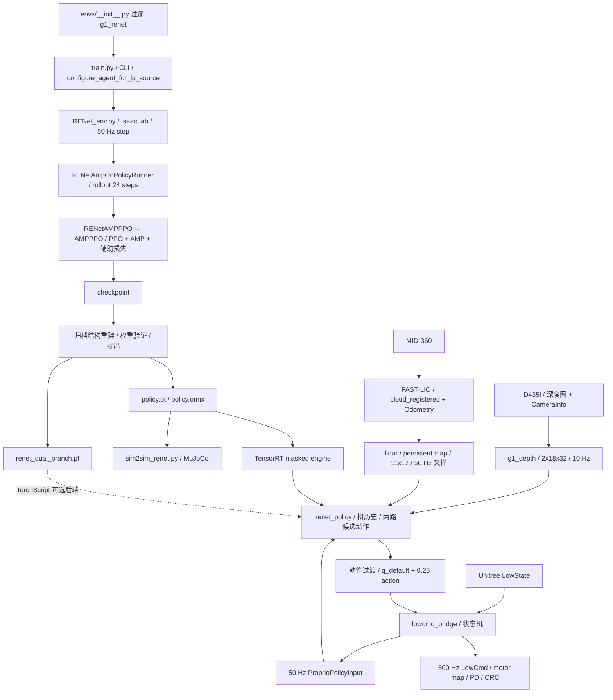

# g1_renet 从训练到部署的代码与模型核查

审阅日期：2026-10-11。目标 run：`logs/g1_renet/2026-09-04_14-11-25`。部署源码：`unitree_deploy_ws`。

本报告依据今天的本地源码、checkpoint 与导出文件，逐层追踪真实调用和数据流，并执行 CPU 模型探针与已有纯逻辑测试。没有连接机器人、启动控制节点、释放运动服务或发送 LowCmd；机载正在运行的源码、安装目录、参数覆盖和 TensorRT 引擎字节不属于本次实测证据。

仓库已有 2026-10-08 报告，但其中 VP/critic 五帧、LP 脚高头、相机 temporal filter、命令范围及部分奖励启用状态已与今天的源码不同。本文另存，避免用历史结论代替当前代码。

## 1. 首先区分三个对象

`g1_renet` 是 **23 个动作关节、LP/VP 两种感知分支、共享 actor、PPO＋AMP＋辅助监督** 的独立任务。LP 消费高程图，VP 消费深度图。本次部署的冻结网络是 legacy VP 64 维版本；当前训练配置已经改成 multi-head VP 69 维版本。

| 项目 | 当前训练配置 | model_60000 / 冻结导出 | 本地 first-real 默认配置 |
|---|---|---|---|
| 外部 actor 观测 | 2120 | 2120 | 2120 |
| 本体缓存 | 10×78 | 10×78 | 10×78 |
| LP query | 最新 5 帧 | 最新 5 帧 | 模型内部决定 |
| VP 编码窗口 | 10 帧 | 10 帧 | 模型内部决定 |
| VP 送入 actor 的特征 | 3＋2＋32＋32＝69 | latent 64 | 冻结模型路径 |
| actor 第一层输入 | 78＋64＋69＝211 | **78＋64＋64＝206** | 冻结模型路径 |
| critic 输入 | 10×85＋187＝1037 | 1037 | 不执行 critic |
| LP 编码 | AME，16 头 cross-attention | 同结构 | 冻结模型路径 |
| LP 脚高监督 | 关闭，系数 0 | 无 LP 脚高头 | 不使用辅助输出 |
| AMP 单帧 | 默认 50，可改 58 | **50**，判别器输入 100 | 不执行 AMP |
| 推理方式 | 训练采样动作 | 导出执行 actor 均值 | TensorRT 原 masked 图执行两次 |
| 分支选择 | 每 20 iterations 交替 | mask 0=VP、1=LP | 初始 VP，遥控分支切换关闭 |

实际配置在 [RENet_cfg.py](../legged_lab/envs/g1/RENet_cfg.py) 的 `G1RENETAGENTCFG.policy`，不能只看 `CustomRslRlPpoActorCriticCfg` 的字段默认值。后者仍默认 `legacy_latent`，前者明确覆盖为 `multi_head`。

`params/` 当前为空，缺少最终 `env.yaml` 和 `agent.yaml`。启动阶段的 `git/TienKung-Lab.diff` 也不能还原后续所有续训修改。因此，可以确定冻结模型的结构、权重、输入约定和 AMP 维度；不能认定它使用了今天完全相同的奖励、随机化和专家文件。今天默认训练上限 50000 不否定归档 checkpoint 的 `iter=60000`。

## 2. 实际入口和主调用链

[envs/__init__.py](../legged_lab/envs/__init__.py) 第 18 行注册：

`g1_renet → G1RENetEnv + G1RENETENVCFG + G1RENETAGENTCFG`。

IDE 当前打开的 `g1_rough_cfg.py` 对应另一个任务。修改它不会自动修改 `g1_renet`。训练入口取得任务注册的配置实例，再由 CLI 覆盖相关参数。

关键文件的职责：

| 文件 | 真实职责与关键位置 |
|---|---|
| [train.py](../legged_lab/scripts/train.py) | AppLauncher、任务配置、CLI、环境、runner、恢复与配置归档；显式 `checkpoint_path` 优先 |
| [RENet_env.py](../legged_lab/envs/g1/RENet_env.py) | `590` 本体观测；`641/661` 真值标签；`722/742` mask；`763/792` 感知拼接；`963` step；`1117` 终止；`1237/1294` 深度处理与历史 |
| [renet_actor_critic.py](../rsl_rl/rsl_rl/modules/renet_actor_critic.py) | 两路编码、共享 actor、特权 critic、辅助预测与新 VP 多头 |
| [renet_amp_on_policy_runner.py](../rsl_rl/rsl_rl/runners/renet_amp_on_policy_runner.py) | `223` rollout；`568` save；`604` load 与约定校验 |
| [renet_amp_ppo.py](../rsl_rl/rsl_rl/algorithms/renet_amp_ppo.py) | 很薄的 AMPPPO 子类；真实优化逻辑在 [amp_ppo.py](../rsl_rl/rsl_rl/algorithms/amp_ppo.py) |
| [lp_height.py](../legged_lab/perception/lp_height.py) | 网格、编码、包级噪声、包延迟与历史；当前只接受 `pgtt_full_atten` |
| [frozen_policy.py](../legged_lab/selector/frozen_policy.py) | `57` 重建归档 legacy 架构；`278` 冻结加载与身份核验 |
| [policy_adapter.py](../legged_lab/selector/policy_adapter.py) | 编码器各执行一次、共享 actor 两次，输出六项 |
| [policy_node.py](../unitree_deploy_ws/src/g1_control/g1_control/policy_node.py) | `281` 接感知数组；`328` 组输入、推理、选择、过渡、发布目标 |
| [lowcmd_bridge.cpp](../unitree_deploy_ws/src/g1_control/src/lowcmd_bridge.cpp) | `357` 目标接收；`494` LowState/按键；`550` 阻尼；`563` 目标；`600` 控制；`641/660` 状态与本体快照 |

## 3. 观测契约：逐个字段对齐

### 3.1 单帧 78 维

| 单帧切片 | 内容 | 训练与部署的语义 |
|---|---|---|
| `[0:3]` | 机体系角速度 | rad/s；所有当前尺度为 1 |
| `[3:6]` | 投影重力 | 直立约 `[0,0,-1]` |
| `[6:9]` | `[vx,vy,wz]` 命令 | m/s、m/s、rad/s |
| `[9:32]` | `q-q_default` | 策略顺序 23 关节，rad |
| `[32:55]` | `dq-dq_default` | 当前默认速度为零 |
| `[55:78]` | 上一步动作 | 尚未乘 0.25 的动作坐标 |

训练从 action buffer 最新的原始策略动作取 previous action，位置执行前才 clip，actor观测整体也clip到±100；当前动作延迟关闭。部署 previous action 是实际发布前完成裁剪和过渡的动作。分支过渡期间，部署缓存包含过渡后的动作，训练缓存没有这层过渡。

部署 [observation.py](../unitree_deploy_ws/src/g1_control/g1_control/observation.py) 用 Unitree IMU **wxyz** 四元数计算重力。ROS TF 使用 **xyzw**；不能混用。训练本体角速度来自 root frame，部署直接采用 IMU gyro，代码没有额外做 IMU→训练 root 的旋转校正，实际安装对齐需由硬件外参证据确认。

### 3.2 完整 2120 维

| 总输入切片 | 形状 | 排列 |
|---|---|---|
| `[0:780]` | 10×78 | 最旧到最新；最新 `[702:780]` |
| `[780:967]` | 11×17 | 一张 LP 地图；行 y 递增、列 x 递增 |
| `[967:2119]` | 2×18×32 | 旧图在前、新图在后；每图行优先 |
| `[2119:2120]` | 1 | 原始 masked 模型：0=VP，1=LP |

双分支 TorchScript 保留最后一个位置以兼容输入宽度，输出不由该 mask 选择。TensorRT runner 会分别将它写为 1、0，执行两个前向。

LP 坐标是躯干 yaw 对齐、世界 Z 向上的 `capture_torso_yaw`：x 从 −0.8 到 0.8 m，y 从 −0.5 到 0.5 m，间距 0.1 m。有效值：

`height = clip(z_torso - z_ground - 0.5, -1, 1)`。

未知格 **−1.1** 在有效范围外，不能填 0。训练 PGTT 向下射线起点的 20 m 偏置只用于发射，不是高度编码参考。valid/confidence/age 位于额外诊断信息，未占用 2120 中的任何字段。

深度是 **image-plane Z**，归一化为 `clip(depth_m, 0.1, 2.5)/2.5`，有效数值区间 `[0.04,1]`。不是欧氏射线距离，也不是把 `[0.1,2.5]` 平移映射到 `[0,1]`。

### 3.3 critic 和监督标签

critic 单帧 85＝上述 clean proprio 78＋真实 body linear velocity 3＋脚接触 2＋脚高 2。10 帧后追加 187 点真值地形，合计 1037。最新速度 `[843:846]`，脚高 `[848:850]`，地形 `[850:1037]`。

环境先构造 clean critic，再给 actor 加本体噪声。脚高标签来自左右足底射线传感器高度减有效 ground hit 的平均高度，clip 到 ±1，同时返回两脚 valid；不能直接解释成未经偏置的鞋底净空。真值地形无命中位置填零，但有独立 valid mask，损失会排除它们；这与 actor LP 未知值 −1.1 是两个契约。

## 4. 已验证的冻结网络内部

本次严格加载重建 legacy 网络，全部 checkpoint 参数匹配。运行 hook 捕获到 LP query `[1,390]`、LP attention 的 query `[1,1,64]` 和地图 key/value `[1,187,64]`，VP attention `[1,12,64]`，VP GRU `[1,10,64]`，actor `[1,206]`，critic `[1,1037]`。这些是前向实测形状。

### LP

1. 最新 5 帧原始本体：5×78＝390。
2. `lp_query_mlp`：390→256→128→64，生成单 query。
3. 高程图两层 5×5 卷积：1→16→61，ELU。
4. 每格 61 维卷积特征＋x、y、encoded height，组成 187 个 64 维 token。
5. 16 头 cross-attention，输出 LP latent 64。

LP 没有 GRU，也没有 attention 后的 LP encoder。配置里保留的 `LidarCnnMlp=[8,16]` 不能当成该 AME 实际卷积结构。LP velocity head 监督的是 query feature，不是 attention 输出的 map latent。

### VP

1. 10 个本体帧分别经共享 MLP 78→256→128→64。
2. 两张 18×32 图各自经同一个单通道 CNN，通道 8、16、32，前两层 max pool；flatten 后 MLP 768→256→128→64。
3. 10 本体 token＋2 深度 token，形成 12 个 token，1 头 self-attention。
4. 保留前 10 个本体对应 token，VP encoder 64→128→64，再经 10 步 GRU，取最后 hidden 64。

`CnnMlp.input_channels=2` 在这里表示两帧历史，并非实际 CNN 接收一张双通道图。GRU 每次完整窗口推理从默认初始状态开始；`is_recurrent=False`，`reset()` 空实现。跨调用的时间信息由输入缓存提供，没有另一份持续累积的 hidden state。

### actor 与当前新 VP

冻结 actor：`[latest proprio 78, mask*LP64, (1-mask)*VP64]`，206→512→256→128→23，ELU。冻结版本的预测速度、地形和脚高用于训练监督，不直接拼进动作 actor。

当前 multi-head VP 把 GRU64 送入速度3、脚高2、context posterior 参数、terrain latent32 等头，actor 使用 `[velocity3,feet2,context_mu32,terrain32]`＝69。context sampling 只用于 VAE 损失，动作推理用 mu。VAE 解码下一时刻 clean proprio78，done transition 排除；当前 beta **0.01**，不是配置类字段默认的 2。

这改变了 actor 第一层从 206 到 211，不能把旧权重直接当成当前多头网络。

## 5. 训练每次 iteration 的实际过程

当前默认 128 个并行环境、physics dt 0.005 s、decimation 4：200 Hz 物理、50 Hz 策略。每个 iteration 每环境采样 24 步，共 3072 transitions；默认 PPO 5 epochs、4 minibatches。

1. runner 设置全局 iteration，环境更新噪声/随机化阶段；每 20 iterations 交替 LP/VP。0～19 LP，20～39 VP，依次重复。runner 在 rollout 开始前重写当前观测最后一列，避免边界首步仍用旧 mask。
2. 训练策略 Normal 分布采样动作。环境 action buffer 处理延迟，clip 到 ±100，再执行 `q_default+0.25*action`。
3. 4 次物理步写位置目标，200 Hz 消费 contact sensor；随后计算该动作对应的任务奖励和 termination。
4. 使用产生本次动作时的 mask/command 记录 branch 指标，避免更新命令后奖励归因错位。
5. **reset 前保存终止 AMP 状态**；runner 将 reset 后的 next AMP 状态替换成该真实终止状态。这样判别器不会学习“摔倒→默认复位”的人工转移。
6. reset、更新下一时刻 command、拼下一观测。runner 得到 AMP 风格奖励、任务奖励混合值及 clean next proprio。
7. 计算 GAE/returns，执行 PPO、AMP discriminator、辅助任务与 VAE 更新；按保存间隔归档 model、optimizer、AMP normalizer 和各项 contract。

当前 PPO：lr 1e−3、adaptive KL 目标 0.01、clip 0.2、entropy 0.005、gamma 0.99、lambda 0.95、policy grad clip 1。actor 经验归一化关闭，冻结推理也是 identity；AMP normalizer 是另一个对象，不能用它归一化 actor 输入。

### AMP 数据与损失

默认 `G1_RENET_AMP_DIM=50`，特征为 **19 非脚踝关节 q＋19 dq＋四个末端各3维位置**。四个末端是左右 wrist/foot，位置转到机器人根节点坐标系。无脚踝只指 AMP 特征：**actor 仍控制全部 23 个关节，含四个脚踝关节**。AMP 的 compact joint order 与 actor interleaved joint order 不同。

当前实际四个文件位于 `datasets/motion_amp_expert_no_ankle`，本次解析结果：

| 文件 | 帧数 | 单帧维度 | dt，秒 | 有效时长，秒 | MotionWeight |
|---|---:|---:|---:|---:|---:|
| stand_to_walk.txt | 517 | 50 | 0.0250161 | 12.9083 | 0.5 |
| walk_turn_around.txt | 454 | 50 | 0.0250366 | 11.3416 | 0.5 |
| walk_turn_left.txt | 336 | 50 | 0.025 | 8.375 | 0.5 |
| walk_turn_right.txt | 371 | 50 | 0.025 | 9.25 | 0.5 |

AMPLoader 归一化轨迹权重，因此四段各 25%；按连续时间插值，采相隔控制 dt＝0.02 s 的状态对，预加载 200000 transitions。IDE 的 `make_g1_23dof/training/amp_no_ankle/walk_turns_40s.txt` **不在当前默认四个路径中**。改该文件不会自动影响当前 g1_renet 专家采样。

历史 checkpoint 判别器第一层 `[1024,100]`，直接证明其 AMP 单帧50；无法据此证明历史最终数据与今天四段相同。58 模式换成全部23关节、23＋23＋12，并使用另一 loader 与 v3 路径。

判别器输入相邻两帧拼接100，经 1024→512→256→1。训练以 MSE 把 expert 回归到 +1、policy 回归到 −1，并加 expert 输入梯度范数趋近0的 penalty，系数10；D 是实数，不是概率。

当前 [discriminator.py](../rsl_rl/rsl_rl/modules/discriminator.py) 实现：

`r_amp = 0.3 * max(1 - 0.25*(D-1)^2, 0)`；

`r_total = 0.7*r_task + 0.3*r_amp`。

task RewardManager 已乘 0.02 s。风格最大贡献因此是 0.09/step；代码实现是加权相加。优化器为一个 Adam 的不同参数组，同时覆盖策略、判别器 trunk/head；判别器 trunk/head 各有 weight decay。

### 辅助监督

当前 velocity coef 1、warmup0；LP全187点和VP前方99点地形各0.5；VP脚高0.2；LP脚高关闭；地形、脚高和 VAE warmup500，采用保存的全局 iteration。地形固定物理目标 clip±1，不做每样本的目标重标定；真值 valid mask 排除无效点。

两路都在更新中接受辅助监督；actor 的 LP/VP mask 并不会关掉未选分支的辅助损失。当前 VAE coef1、beta0.01，以重建下一 clean proprio和KL约束训练 context。部署路径只执行动作 forward，critic、AMP 和多数监督头不参与电机目标生成。

### 随机化、感知与终止

当前 LP 是 ground-only PGTT 垂直射线，不模拟真实 MID-360 扫描稀疏性和 FAST-LIO 建图；通过残差噪声模拟地图误差。环境强制 scene lidar=None，`resolve_pgtt_height_cfg()` 只接受 `pgtt_full_atten`。历史多来源文档不能当成今天仍支持 mid360/pgtt_front 的证据。

本体角速度±0.2、重力±0.05、q±0.01、dq±1.5 的均匀噪声；命令和 previous action 不加噪声。startup 摩擦/恢复系数和 torso 质量±5kg随机化；reset 姿态/速度随机化；从 iteration0 开始每10～15秒推 XY 速度±1m/s。动作 delay 当前关闭。

VP 从 iteration0 开始距离相关 Gaussian noise 和50%概率 Gaussian blur，更新每5控制步＝0.1 s；图像历史2张，reset 后首张重复初始化。LP noise 从 iteration30000 开始：1～3cm随机高度、±2cm bias/XY、±1° yaw、dropout、缺块、0.1m量化和0～2个包延迟。噪声只对新 packet 更新，held frame 不每个50Hz步重新随机。

奖励含速度/转向跟踪、姿态、能耗、关节加速度、动作变化、接触/脚滑、脚受力、腾空、关节偏离/限位和 termination 等。`vp_idle_when_commanded` 与左右 `stair_edge_penalty` 在今天配置中均被注释，不应把它们计入当前奖励。

常规 termination 是 torso contact force >1N 或20s timeout；`robot.limit_angle=0.8` 虽存在，`check_reset()` 没有倾角判断。selector 采集的失败判定另有 tilt/clearance 条件，不能倒推成环境真实 termination。

## 6. checkpoint、导出与身份实证

本次 CPU PyTorch 2.7.0 加载三个 checkpoint 和两个 TorchScript 文件。两个导出各87个 `policy.*` state 张量，去前缀后与 **model_60000 全部逐元素完全相同**；与50000、54000不完全相同。

| 文件 | 本次 SHA-256 |
|---|---|
| model_60000.pt | `d588c113dfa797afb486eef69e15889e4787e60257e66c36d6e64f00976f1566` |
| exported/policy.pt | `7a34a61b4b6f391f628b46b4da106d99b72f9034dab5f62386bac7db87a351b1` |
| exported/policy.onnx | `be807a35d87cc780ae861ac874ecbff67eb68aa3988736347d4e873d1202a049` |
| exported/renet_dual_branch.pt | `c512197e3c5e9951c3f183d5be4317777a29bba33be3535370b02d8282b2fb4e` |

checkpoint 旧来源名 `pgtt_full` 携带实际 AME contract，export 元数据统一为 `pgtt_full_atten`。这里来源名迁移不改变 LP 实际结构。冻结 builder strict load 成功；hook 形状进一步验证结构。

ONNX checker 通过，opset17，float32 输入 `obs[1,2120]`，输出 `actions[1,23]`。双分支 contract v2，输出依次 LP latent64、VP latent64、LP velocity3、VP velocity3、LP action23、VP action23。部署仅使用第5、6项。

19组固定seed有限值输入比对，双分支对原 masked 模型：LP最大绝对误差 **5.7220e−6**，VP **6.2585e−7**，六项输出均有限。扰动未选感知的有限值，原模型所选动作差为0。

异常输入 probe 明确区分后端：

| 输入情况 | 原 masked policy.pt | dual TorchScript 的所选动作 |
|---|---|---|
| LP模式，未选depth全NaN | 动作非有限 | 有限，和baseline差0 |
| VP模式，未选LP全NaN | 动作非有限 | 有限，和baseline差0 |

原模型先计算两路，再用乘法 mask，0×NaN 仍是NaN。dual 用 `zeros_like` 组装另一分支占位，所以所选动作隔离；但其未选分支相关输出仍会非有限，不能说整个六输出全部隔离。TensorRT 使用 masked ONNX，两次执行；本次没有本地对应 engine/CUDA运行，未实测其NaN行为或速度。

### 当前播放/加载不能直接替代冻结路径

[renet_checkpoint.py](../rsl_rl/rsl_rl/utils/renet_checkpoint.py) 第6行的 VP contract 校验在 runner.load 最先执行。旧 checkpoint 没有 multi-head VP contract，而当前配置 version不是legacy时，会抛出 `Legacy checkpoint has no multi-head VP contract; train the new VP from scratch.`。因此今天按当前默认 cfg 调用训练恢复或 `play_new_renet.py`，**会拒绝直接加载这个旧模型**，并非自动转成多头。

`play_new_renet.py` 成功加载后默认会导出到 run/exported 的原文件名。其“加载失败”与“成功后的默认写出位置”需分别理解。查看部署模型应保留归档 legacy 重建逻辑；新训练与新导出采用独立输出目录。现有双分支导出脚本默认 checkpoint 还指向 `/data/Tienkung_lab/logs/g1_renet/model_60000.pt`，需要显式指定本次本地run；这不是本文替用户执行的命令。

## 7. MuJoCo 检查覆盖什么

[sim2sim_renet.py](../legged_lab/scripts/sim2sim_renet.py) 直接加载冻结 masked policy.pt。相同10×78历史、187高程、两张深度、mask、0.25动作scale、默认姿态、关节名称映射及PD参数；仿真仍200Hz物理、50Hz动作。

MuJoCo 显式 `tau=kp*(q_target-q)-kd*dq` 并按仿真 torque_limits 裁剪；IsaacLab 用隐式 actuator；真机发 q/dq/kp/kd/tau 给电机侧。增益和目标一致不证明饱和行为完全相同。

它的PGTT也来自ground-only射线，深度来自训练几何的相机；支持LP/VP手动切换、LiDAR丢包及深度故障。默认仿真LP、first-real默认VP。脚本源码审阅不等于重新跑过物理闭环，本次未运行MuJoCo。

## 8. 真机 VP：D435i 到策略图像

入口 [first_real_control.launch.py](../unitree_deploy_ws/src/g1_control/launch/first_real_control.launch.py) 启动 D435i 深度848×480×30、不启用RGB/IR/相机IMU，不启用align或pointcloud；启动 `g1_depth/depth_policy_preprocessor`。

[depth_policy.py](../unitree_deploy_ws/src/g1_depth/g1_depth/depth_policy.py) 和 [depth_policy_preprocessor.py](../unitree_deploy_ws/src/g1_depth/g1_depth/depth_policy_preprocessor.py) 的链路：

1. 读取 `/camera/depth/image_rect_raw` 与 CameraInfo，优先用P，再用K。
2. 正确处理图像stride/endian；16UC1毫米乘0.001，32FC1直接米。
3. 生成训练64×36、FOV89.51°×58.29°的像素射线，用真实内参映到原图，nearest采样；不是简单resize 848×480。
4. crop top18、bottom0、left16、right16，得到18×32。
5. 处理无效值，按blur开关处理，再clip0.1～2.5并除2.5。
6. 按0.1s固定deadline采图，首张重复，维护旧→新两帧。该deadline避免相机约30Hz时每次重新计时产生约7.5Hz采样。

当前 [depth_policy.yaml](../unitree_deploy_ws/src/g1_depth/config/depth_policy.yaml) `invalid_depth_mode=training`：只将inf/nan填far；真实D435i测不到的0保留至clip，被编码成0.04。训练raycaster不产生这种0孔洞，所以实现同一数值规则不意味着孔洞分布也与训练相同。视场外单独填far。

当前 `blur_enable=false`；[realsense_d435i.yaml](../unitree_deploy_ws/src/g1_depth/config/realsense_d435i.yaml) 的spatial/temporal/decimation/disparity/hole-filling均false。当前训练blur是噪声启用后的50%概率，不应继续使用“训练固定模糊、机载temporal=true”的旧描述。冻结最终训练预处理缺少完整参数归档，不能由当前cfg定论。

代码检验projection coverage≥0.99、valid ratio≥0.5、source age≤0.2s、future tolerance0.05s，并以20Hz watchdog检查0.25s source timeout。**这些只生成诊断，不停止有限值policy图发布**。watchdog可更新健康量，但policy_node只缓存message.history，不读取header/valid/source_age/valid_ratio/support；冻结模型也没有健康字段输入。

训练相机mount在torso、pitch姿态固定。真实投影处理只对齐内参/FOV，未额外把不同安装外参的深度图重投影到训练mount。硬件相机角度与位置是否吻合，本次没有现场标定证据。

## 9. 真机 LP：MID-360、FAST-LIO、持久高程

first-real 使用ROS包 `lidar` 的 `persistent_elevation_map` 和 [phase3_persistent.yaml](../unitree_deploy_ws/src/lidar/config/phase3_persistent.yaml)。机载源码目录名可为 `g1_lidar`，包名仍为 `lidar`；本地源码目录为 `src/lidar`。

1. `/cloud_registered` 已在FAST-LIO `camera_init` 世界系，不再乘一次odom pose；静态TF把它转换到g1_world。
2. `/Odometry` 用于torso位置/yaw，匹配最近cloud时间，容差0.03s，无插值；DDS depth1，过载丢旧cloud，避免排队延迟。
3. 由FAST-LIO body pose与body_to_torso外参构造torso采样位姿。launch的torso→livox TF与地图body_to_torso承担不同用途，不能省略后者；外部FAST-LIO配置在机载工作空间，本次未查验其当前字节。
4. 相对torso高度筛选[-1.5,0.5]m；head box只过滤头部区域，并非全机器人自体过滤。
5. [persistent_grid.py](../unitree_deploy_ws/src/lidar/lidar/persistent_grid.py) 每扫描每10cm世界格取**最高点**，以测量方差和旧状态融合；不是取最低ground点或平均所有点。
6. 新旧高度冲突>3sigma时先候选，3次一致、5cm容差后替换；保留半径2.5m；没有时间硬删除，variance以1e−6m²/s增长，超过0.01m²才对policy判无效。
7. [persistent_elevation_map.py](../unitree_deploy_ws/src/lidar/lidar/persistent_elevation_map.py) 内部3.2m窗口，输出1.6×1.0m、11×17；世界格最近邻查询加2cm Schmitt迟滞，不对台阶高度插值。
8. 点云约10Hz融合，另一个采样线程50Hz按最新/预测torso pose采图，使用与训练同号的 `z_torso-z_ground-0.5` 和−1.1未知值。

位姿预测用最近0.25s位置/yaw拟合，最小0.1s跨度、外推上限0.25s，linear deadband0.08m/s、yaw0.04rad/s、yaw gain0.5，有速度上限。50Hz发布只是重采样旧地图，不表示获得50Hz新LiDAR数据。message.source_stamp保留最近融合cloud来源，与header采样时间不同。

定位跳变>0.5m或45°、cloud时间回退会清地图/预测器；yaml注释说“清图并回VP”，但当前代码只有清图逻辑，**没有发送policy切换事件**。地图停止更新时旧格可长时间保留，policy_node又丢弃source_stamp/valid；不能把持续50Hz发布解释为LP新鲜性保证。

## 10. 真机推理、过渡、映射与接管状态机

### 默认参数究竟做什么

[control_first_real.yaml](../unitree_deploy_ws/src/g1_control/config/control_first_real.yaml) 指定 TensorRT、FP32 no-TF32 engine 的机载路径和expected hash；初始VP，遥控速度启用，分支切换关闭，dry_run=false，START后自动释放运动服务。命令x[-0.4,0.8]、y[-0.4,0.4]、yaw[-1.57,1.57]；deadzone0.1；LY前进为正，LX/RX符号反转。当前训练x[-0.6,1.0]、y[-0.5,0.5]，两者范围不同。

`control_dry_run.yaml` 启用按键和分支切换，但不发LowCmd且遥控命令关闭。`control.yaml` 是另一套保守默认。最终行为由实际launch选择及参数覆盖决定，不能只看文件名包含control。

TensorRT引擎expected hash是 `6761e83826331db123fb9a4ef4bbaf8b6cfded928077c21cd6da5713d452118a`。这是本地配置值，不是本文重新下载或计算机载引擎后的结论。TorchScript的expected hash与本次本地dual文件相同；当前选TensorRT时只加载/核验engine，并不执行dual文件。

### Python 50Hz路径

policy_node本身没有独立50Hz推理timer；由C++本体快照回调触发。inactive时更新遥控边沿；收到 `policy_requested` 才清历史/previous action/sequence，seed过渡起点为零，等待下一快照。

开始推理要求 proprio、depth、elevation 三者都至少到过一次，即使VP-only也要有LP数组；只检shape。它将最新缓存感知与本体历史拼2120，推理两路，按_mode选动作，clip±100，再5步过渡。过渡alpha为0.2、0.4、0.6、0.8、1，固定起点是上次实际动作，终点为每帧新的候选动作。输出 `q_target=q_default+0.25*action`；previous action存实际过渡后的action，header盖当前时间。

[tensorrt_runner.py](../unitree_deploy_ws/src/g1_control/g1_control/tensorrt_runner.py) 对同一个masked engine强制mask1和0，串行执行两次，输出两路动作；并非使用一个六输出TensorRT图。

### 23关节和PD

[contracts.py](../unitree_deploy_ws/src/g1_control/g1_control/contracts.py) 明确policy interleaved order→Unitree35槽：

`[0,6,12,1,7,15,22,2,8,16,23,3,9,17,24,4,10,18,25,5,11,19,26]`。

受控motors为0…12、15…19、22…26；13/14/20/21/27/28和29…34 disabled。默认双hip pitch−0.2、knee0.42、ankle pitch−0.23、双shoulder pitch0.35、left/right shoulder roll±0.18、elbow0.87，其余受控关节0。

| 关节组 | kp | kd |
|---|---:|---:|
| hip pitch / knee / waist yaw | 200 | 5 |
| hip roll / hip yaw | 150 | 5 |
| ankle pitch / roll | 20 | 2 |
| shoulder pitch / roll | 100 | 2 |
| shoulder yaw / elbow | 50 | 2 |
| wrist roll | 15 | 2 |

这些姿态/增益与当前 [G1_23CFG](../legged_lab/assets/g1/g1_29.py) 对应。桥接普通控制发送motor mode1、q目标、dq0、tau0、kp/kd，并写mode_pr=0、LowState的mode_machine及Unitree HG格式CRC。代码没有把sim torque_limits直接移植成bridge目标限位。

### C++状态机

`WAITING → START → ACQUIRING → STANDING(3s) → HOLDING → A → POLICY`。

START前不发LowCmd；真实模式worker调用MotionSwitcher检查/释放，再确认活动服务名为空；500Hz控制timer确认ownership ready后，从最新measured q开始3秒线性站立。HOLDING继续默认姿态。A清旧target、记录request时间并发policy_requested；只有收到不早于该request的新target才进入POLICY。这个epoch gate解决启动时旧target接管问题。

SELECT有优先级，已接管后进入锁存DAMPING；等待释放时按SELECT则释放完成后直接damping。DAMPING的23个motor仍mode1，kp0、kd10、q/dq/tau0；这是受控阻尼，不是全部电机mode0。重启才可重新arm。dry-run路径最后不发布LowCmd，即使配置了隔离话题也不发。

## 11. selector 的位置

[selector/config.py](../legged_lab/selector/config.py)、[collector.py](../legged_lab/selector/collector.py)、frozen adapter构成另一条冻结策略上的监督风险学习链路。collector保存物理/传感器/随机流/动作过渡等状态，对同一起点分别强制LP/VP跑短0.4s、长1.0s counterfactual，并做重复一致性检查。

selector输入单帧283＝proprio78＋两路latent128＋velocity6＋actions46＋sensor health16＋cross7＋mode/dwell2，5张10Hz历史；网络MLP→GRU→4个LP/VP×short/long风险输出。runtime有健康timeout、switch margin、确认次数、dwell及过渡策略。

但今天的g1_control policy_node没有加载selector model，也没有调用OnlineSelectorRuntime。双路候选动作已经存在，不代表自动选择器已经上线。first-real固定VP；即使打开手动switch，也只是L1 LP/R1 VP。selector默认checkpoint路径仍是 `/data/Tienkung_lab/...`，与当前本地run位置不同。

## 12. 已确认的缺口及其实际后果

| 代码事实 | 具体后果 | 证据 |
|---|---|---|
| policy只缓存感知数组，忽略stamp/valid/age | 深度停止或地图只重采旧数据时仍可继续推理；没有自动LP/VP健康fallback | policy_node.py:281/284/328 |
| bridge本体timer仅检查have_lowstate | LowState停流后仍以50Hz发布缓存数据；header仍旧，policy不检它 | lowcmd_bridge.cpp:660 |
| target_age只诊断，POLICY持续使用last target | policy进程停止后500Hz仍发最后q目标；没有超时降级 | lowcmd_bridge.cpp:563/641 |
| 输入/目标只有shape检查，没有有限值门控 | NaN不因np.clip被清除；OnTarget直接存q_target | policy_node.py:328，lowcmd_bridge.cpp:357 |
| 动作clip±100，没有q限位/变化率限制 | scale0.25后可对应±25rad，不能把该clip视为机械位置约束 | contracts.py，policy_node.py |
| 当前cfg multi-head，旧checkpoint legacy | 默认runner.load直接拒绝；外部宽度相同也不能说明架构兼容 | renet_checkpoint.py:6 |
| map跳变清图但不切policy模式 | 注释承诺的回VP未接入执行 | persistent_elevation_map.py，policy_node.py |
| 本地install缺少新增消息与g1_control可执行入口 | 当前源码不等于本地已构建可运行产物 | install/g1_policy_msgs、install/g1_control |

本地install中g1_policy_msgs只找到Depth/Elevation旧消息，缺ProprioPolicyInput、PolicyJointTarget、ControlStatus；g1_control只见旧骨架安装内容，没有当前控制可执行文件/launch/config。该结论只针对本地install，不能据此判断机载install也旧。机载外部Livox/FAST-LIO配置、真实相机/IMU外参、实时负载与实际生效参数仍需读取机器人现态才能确定。

本次先核查并记录这些行为，没有修改训练/部署实现。

## 13. 本次执行的验证和复查入口

完成：三个checkpoint结构/元数据读取；两个TorchScript权重逐张量对齐；19组双分支有限值parity；未选感知有限扰动/NaN probe；冻结builder strict load和内部shape hook；ONNX checker和hash；当前四个AMP文件的元数据/维度/hash；已有pure tests **40 passed**。

40项测试来自g1_control mapping/history/remote/transition、g1_depth预处理、persistent grid和pose prediction。它们不覆盖ROS运行、C++编译、真实DDS、TensorRT engine或机器人闭环。没有将旧报告中的SSH、机载TensorRT速度/误差或实机日志算作今天重新验证。

可复查文件在 [work/g1_renet_training_to_deploy_audit_20261011](../work/g1_renet_training_to_deploy_audit_20261011)：

- `artifact_audit.py` / `artifact_audit.json`：checkpoint身份、export元数据、张量匹配与parity。
- `supplemental_audit.py` / `supplemental_audit.json`：内部运行形状、dual NaN隔离、ONNX、AMP元数据和关键源码SHA。
- `validation.md`：本次验证命令及边界。

源码SHA作为审阅时刻快照保存；后续文件改动时，数值probe仍可运行，但“当前配置”应重新读取。
