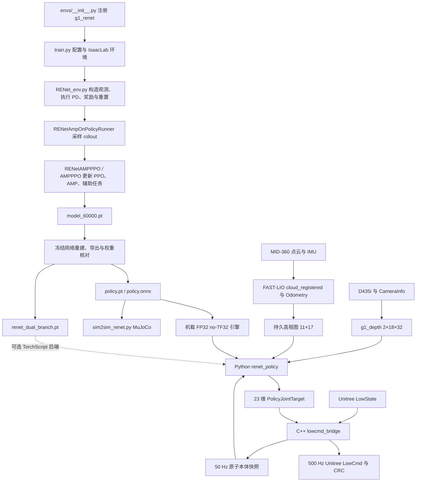

# g1_renet：训练、冻结模型、MuJoCo 与 G1 机载部署

审阅日期：2026-10-08，Asia/Shanghai。训练仓库：`/home/cjh/TienKung-Lab`；目标模型目录：`logs/g1_renet/2026-09-04_14-11-25`；机载电脑：`unitree@192.168.3.157`；机载工作空间：`/home/unitree/cjh`。

这套系统是一个 **23 自由度、LP/VP 双感知分支、共享 actor、PPO＋AMP 的运动策略**。LP 接收高程图，VP 接收深度图。机载控制将策略推理与电机命令发布分成两个进程：Python 接收 50 Hz 本体快照并推理，C++ 以 500 Hz 发布位置 PD 命令。

本次读取本地训练与部署实现，通过 SSH 下载机载源码进行逐文件比对，核对安装配置、模型哈希与历史日志，并执行本地模型探针和机载离线 TensorRT 比对。没有启动 ROS 控制节点、释放 Unitree 运动服务或发送电机控制指令。

## 1. 三个版本必须分开理解

| 项目 | 当前训练源码 | 本次部署的冻结模型 | 机载实际配置 |
|---|---|---|---|
| Actor 输入宽度 | 2120 | 2120 | 2120 |
| 本体传输历史 | 10×78 | 10×78 | 10×78 |
| AME LP 查询历史 | 最近 5 帧 | 最近 5 帧 | 由冻结模型决定 |
| VP 编码历史 | 最近 5 帧 | **10 帧** | **10 帧** |
| Critic 输入 | 5×85＋187＝612 | 10×85＋187＝1037 | 部署不执行 critic |
| LP 来源名 | `pgtt_full_atten` | checkpoint 记为 `pgtt_full`，导出记为 `pgtt_full_atten` | FAST-LIO 持久高程图提供同形状输入 |
| AMP 单帧 | 默认 50，可切换 58 | **50**，判别器输入 100 | 部署不执行 AMP |
| LP 脚高头 | 已新增 | 旧模型没有该新增头 | 部署动作不使用脚高头 |
| VP 图像模糊 | 50% 概率触发，跟随噪声开关 | 导出不封装图像预处理；归档部署说明与 MuJoCo 使用固定 Gaussian blur | 预处理 `blur_enable=false`；相机 temporal filter **true** |
| 速度命令范围 | x `[−0.6,1.0]`，y `[−0.5,0.5]` | 最终训练范围未完整归档 | first-real：x `[−0.6,0.8]`，y `[−0.5,0.5]` |

`params/` 目录目前为空，缺少该 run 的 `agent.yaml` 和 `env.yaml`。`git/TienKung-Lab.diff` 保存的是启动阶段的源码差异，其中还是早期 MID-360 路线；最终 checkpoint 已包含 PGTT AME 约定。因此，**最终模型结构、权重和 LP 编码约定可以直接核实，但最终续训阶段全部奖励、噪声、数据集路径及命令行参数不能由当前 cfg 或启动 diff 完整还原**。

当前 cfg 的默认 `max_iterations=50000` 也不意味着本次模型只训练到 50000：目标 checkpoint 的 `iter=60000`。后续训练参数应以续训记录为准。

代码中的历史注释和已有文档也有滞后。例如当前足底支撑惩罚实际权重为每脚 `−0.02`，部分已有文档仍写 `−0.05`。本报告的当前配置数值按实际代码读取。

## 2. 全流程与文件职责

| 入口或文件 | 职责 |
|---|---|
| [任务注册](../legged_lab/envs/__init__.py) | 将 `g1_renet` 绑定到 `G1RENetEnv`、`G1RENETENVCFG`、`G1RENETAGENTCFG` |
| [训练入口](../legged_lab/scripts/train.py) | 启动 IsaacLab，解析 CLI，选择 LP 来源，创建环境与 runner，恢复 checkpoint，保存配置并训练 |
| [训练配置](../legged_lab/envs/g1/RENet_cfg.py) | 场景、传感器、观测历史、命令、奖励、随机化和 PPO/AMP 配置 |
| [训练环境](../legged_lab/envs/g1/RENet_env.py) | 本体/特权观测、地图与深度历史、动作执行、标签、终止与重置 |
| [机器人资产](../legged_lab/assets/g1/g1_29.py) | G1 23-DOF URDF、初始姿态、训练 PD、关节力矩/速度限制 |
| [网络](../rsl_rl/rsl_rl/modules/renet_actor_critic.py) | LP、VP、共享 actor、critic、速度/地形/脚高辅助头 |
| [Runner](../rsl_rl/rsl_rl/runners/renet_amp_on_policy_runner.py) | 环境采样、AMP 终止状态处理、奖励混合、checkpoint 元数据及迁移 |
| [PPO/AMP](../rsl_rl/rsl_rl/algorithms/amp_ppo.py) | PPO、AMP 判别器、辅助监督与优化器更新 |
| [播放与普通导出](../legged_lab/scripts/play_new_renet.py) | 使用当前训练配置实例化、加载、播放，并默认导出 |
| [冻结双分支导出](../legged_lab/scripts/export_renet_dual_branch.py) | 重建归档 10 帧 VP、1037 维 critic 架构，验证冻结权重和两路动作一致性 |
| [MuJoCo](../legged_lab/scripts/sim2sim_renet.py) | 同一策略的传感器、关节顺序与 PD sim2sim 检查 |
| [Python 部署](../unitree_deploy_ws/src/g1_control/g1_control/policy_node.py) | 历史、遥控命令、推理、分支选择、动作过渡与目标消息 |
| [C++ 部署](../unitree_deploy_ws/src/g1_control/src/lowcmd_bridge.cpp) | LowState、状态机、运动服务接管、映射、PD 参数与 LowCmd CRC |

机载目录 `src/g1_lidar` 的 **ROS 包名仍是 `lidar`**，Python 模块也叫 `lidar`。本地对应目录为 `unitree_deploy_ws/src/lidar`。目录名与 `ros2 run` 的包名不能互相替换。

## 3. 策略输入、历史与动作的固定约定

### 3.1 单帧本体观测

单帧 78 维，所有默认观测比例均为 1：

| 单帧索引，左闭右开 | 内容 | 单位或含义 |
|---|---|---|
| `[0:3]` | 根节点机体坐标系角速度 | rad/s |
| `[3:6]` | 机体坐标系投影重力 | 直立时约 `[0,0,−1]` |
| `[6:9]` | `[vx,vy,wz]` 命令 | m/s、m/s、rad/s |
| `[9:32]` | `q−q_default` | 23 个策略顺序关节，rad |
| `[32:55]` | `dq` | rad/s；默认关节速度为 0 |
| `[55:78]` | 上一步动作 | 23 维未乘 0.25 的动作 |

Actor 不直接获得真实根节点线速度；训练的速度估计标签来自 critic 特权观测。机载重力由 Unitree IMU 的 **wxyz** 四元数计算，不能当成 ROS **xyzw** 顺序使用。

### 3.2 完整网络输入

| 完整输入索引，左闭右开 | 形状 | 约定 |
|---|---|---|
| `[0:780]` | 10×78 | 从最旧到最新；最新帧 `[702:780]` |
| `[780:967]` | 11×17 | 一张 LP 高程快照；按 y 递增、每行 x 递增 |
| `[967:2119]` | 2×18×32 | 从旧图到新图，每图行优先 |
| `[2119:2120]` | 1 | `0=VP`，`1=LP` |

LP 网格：x `−0.8…0.8 m`，y `−0.5…0.5 m`，间距 `0.1 m`，坐标系 `capture_torso_yaw`。只有 yaw 跟随躯干，Z 保持向上。有效编码为：

`h = clip((z_torso − z_ground − 0.5) × 1.0, −1, 1)`。

未知格为 **−1.1**，不是 0，也不是有效范围下限 −1。地图置信度与 valid 标志作为诊断消息传输，**没有追加到 2120 维策略输入**。PGTT 扫描器的参考 Z 与 torso 一致；20 m 是射线起点偏置，不能作为高度编码参考。

深度输入使用 image-plane depth，处理后为 `clip(depth_m,0.1,2.5)/2.5`，正常值在 `[0.04,1]`。这不是减去 0.1 后重新映射到 `[0,1]`。

本体约 50 Hz；深度历史采集约 10 Hz，相邻两张图相隔约 100 ms；训练 LP 快照同为 10 Hz。部署 LP 地图点云融合约 10 Hz，但当前位姿重新采样与发布为 50 Hz。**图像/地图更新频率与策略频率是不同的。**

### 3.3 动作与 PD

策略输出为 23 维动作，不是关节绝对角度，也不是力矩：

`q_target = q_default + 0.25 × clip(action,−100,100)`。

训练每个策略步执行 4 次 `0.005 s` 物理步，策略周期 `0.02 s`。IsaacLab 使用关节位置目标与隐式 actuator；MuJoCo 显式计算 `tau = kp×(q_target−q)−kd×dq` 并按仿真力矩限制裁剪；机载发送 q/dq/kp/kd/tau 字段，由机器人电机控制实现 PD。三者的 PD 目标一致，但 actuator 实现和饱和行为不能仅凭增益一致就认定完全相同。

默认姿态：双髋 pitch `−0.20`，双膝 `0.42`，双踝 pitch `−0.23`；双肩 pitch `0.35`；左肩 roll `0.18`、右肩 roll `−0.18`；双肘 `0.87`；其余受控关节为 0，单位 rad。

| 关节组 | kp | kd |
|---|---:|---:|
| hip pitch、knee、waist yaw | 200 | 5 |
| hip roll、hip yaw | 150 | 5 |
| ankle pitch、ankle roll | 20 | 2 |
| shoulder pitch、shoulder roll | 100 | 2 |
| shoulder yaw、elbow | 50 | 2 |
| wrist roll | 15 | 2 |

当前部署只有动作 `±100` 裁剪，没有软关节目标限位或目标变化率限制。`±100×0.25=±25 rad`，因此它不能视为机械位置保护。

## 4. 冻结模型的 LP、VP 与共享 actor

### LP：AME 点级交叉注意力

1. 从 10 帧传输历史中取最近 5×78＝390 维原始本体数据。
2. `lp_query_mlp`：390→256→128→64，形成一个 query。
3. 11×17 高程图经两层 5×5 卷积：1→16→61 通道。
4. 每格将 61 维卷积特征与 `(x,y,encoded_height)` 拼接，形成 187 个 64 维 token。
5. 16 头 cross-attention：本体 query 查询地图 key/value，得到 64 维 LP latent。

这份模型的 LP **没有 LP GRU，也没有注意力之后的 LP encoder**。`LidarCnnMlp` 的配置字段仍被保留，但不能据此把冻结 AME 路线解读为“整张地图只压成一个 token”的旧路线。

### VP：本体与深度 token 融合

1. 归档模型使用全部 10 个本体帧；各帧经共享 `proprio_embedding`：78→256→128→64。
2. 两张 18×32 图分别进入同一个单通道 CNN，形成两个 64 维深度 token。`input_channels=2` 表示两帧历史，实际 CNN 并非直接把两帧叠成一次双通道卷积。
3. 10 个本体 token＋2 个深度 token 经 1 头 self-attention。
4. 取本体对应的 10 个融合 token，经 VP encoder 与 GRU，输出最后一个 64 维 latent。

GRU 每次处理完整观测窗口时从默认初始状态开始；`is_recurrent=False`，`reset()` 是空实现。部署并未在推理调用之间维护另一个长期 GRU hidden state，历史由外部观测缓存承载。

当前训练 VP 改为最近 5 帧，参数形状可以仍然相同，但行为已经改变。本次数值探针修改旧五帧时，冻结 VP 动作明显变化，确认冻结图确实保留 10 帧依赖。

### 共享 actor 与辅助头

Actor 输入为 `current_proprio(78) + masked_LP_latent(64) + masked_VP_latent(64)`，共 206 维；MLP 为 206→512→256→128→23，ELU 激活。

速度、地形与脚高预测用于训练监督；速度预测没有被显式拼进 actor 输入。冻结双分支导出的六个输出顺序是：LP latent、VP latent、LP velocity、VP velocity、LP action、VP action。机载控制只使用最后两项。

原始 masked `policy.pt` 对两路 latent 使用乘法掩码。这是数值路由，不是隔离执行：本次给未选分支输入 NaN 后，所选动作的 23 个值仍全部为 NaN。独立双分支 TorchScript 使用真正的零占位组装各自 actor 输入；机载 TensorRT 后端运行的仍是原 masked ONNX 图两次。本文的 TensorRT 一致性比对使用有限值输入，未验证该后端的异常值隔离行为。

## 5. 当前训练如何进行

任务入口调用 `configure_agent_for_lp_source()`，随后创建环境和 `RENetAmpOnPolicyRunner`。源码保留四个明确 LP 来源：

| 来源 | 输入 | 编码器 |
|---|---|---|
| `mid360` | 物理射线模拟点云、滚动图，11×17 | legacy 单地图 token、LP encoder、LP GRU |
| `pgtt_full` | ground-truth 地形扫描＋建图残差，11×17 | legacy 路线 |
| `pgtt_front` | 前半矩形图，11×9 | legacy 路线 |
| `pgtt_full_atten` | 全图 PGTT，11×17 | 本次冻结模型所用 AME 路线 |

PGTT 路线仅创建选中的地形扫描器，关闭物理 LiDAR；VP 与特权地形标签仍存在。本次冻结模型在 checkpoint 中使用历史名称 `pgtt_full`，同时携带 AME encoder contract；当前 loader 有专门迁移逻辑，将这组旧名称解释为 `pgtt_full_atten`。单看来源字符串不能决定网络结构。

当前训练一个 iteration：

1. 根据全局迭代数选择 actor 分支。默认每 20 次迭代交替，0～19 为 LP，20～39 为 VP；所有环境共享这一块的模式。另有 random/lp/vp 模式。
2. 每个环境采样 24 个控制步；训练从策略分布采样动作，部署执行均值。
3. 环境执行位置目标，计算任务奖励、终止与下一观测。
4. AMP 读取当前状态与真实下一状态；终止环境的 AMP 状态在 reset 前缓存，避免将终止→重置姿态当成自然动作转移。
5. AMP 判别器生成风格奖励，与任务奖励相加混合；GAE 计算优势和 returns。
6. PPO 进行 5 个 epoch、4 个 minibatch 更新，同时更新判别器与辅助预测头。

当前任务奖励覆盖 XY/yaw 速度跟踪、姿态、能耗、关节加速度、动作变化、接触、脚滑、脚受力、踏空、步行腾空时间、关节偏离/限位和终止；新增 VP 收到命令但不移动惩罚与左右足底支撑不足惩罚。地形包括上下楼梯、boxes、平台、上下坡和有底 gap，并按完成距离调整难度。

当前常规终止条件是 torso 接触力超过阈值或达到 20 s。`robot.limit_angle=0.8` 配置存在，但当前 `check_reset()` 没有据此加入倾角终止判断。

AMP 与 actor 的关节顺序不同。默认 50 维 AMP＝19 个非脚踝关节位置＋19 个速度＋左右手/脚各 3 维位置；末端位置旋转到根节点坐标系。判别器接收相邻两帧，故输入 100 维。58 维模式包含所有 23 个关节，判别器输入 116。冻结 checkpoint 首层实际为 `[1024,100]`，证明使用 50 维格式；它不能证明最终使用的是当前新四段 PKL 数据集。

当前奖励混合实现为：

`r_amp = 0.3 × max(1−0.25×(D−1)²,0)`；

`r_total = 0.7×r_task + 0.3×r_amp`。

任务奖励由 RewardManager 乘控制步长。代码中某些旧注释写“任务奖励乘判别器分数”，与实际 `Discriminator._lerp_reward()` 不一致。上面系数是当前 cfg，最终归档续训的系数缺少完整配置证据。

当前 critic 单帧 85 维＝78 本体＋3 真实线速度＋2 脚接触＋2 脚高；五帧历史后追加 187 维真实地形。最新速度标签 `[418:421]`，脚高 `[423:425]`。LP 重建全图 187 点，VP 重建前方 99 点；标签来自无噪声特权数据，有独立 valid mask。LP/VP 两路每次都接受辅助监督，actor 执行掩码不屏蔽另一分支的辅助损失。

当前辅助系数：速度 1.0，LP/VP 地形各 0.5，LP/VP 脚高各 0.2；地形与脚高 warmup 500 次。旧模型缺少新辅助约定与 LP 脚高头，loader 会初始化新增头、调整 VP 地形目标约定并迁移优化器；50/58 维 AMP 或旧预处理约定也可能触发判别器与统计重建。

当前随机化：

- 摩擦/恢复系数和 torso 质量在 startup 随机化；质量增量 ±5 kg。
- 推力从训练开始计时，每 10～15 s 改变 XY 速度，范围 ±1 m/s。
- 本体噪声作用于角速度、重力、关节位置与速度；命令和上一动作不加噪声。
- VP 从第 0 次启用距离相关高斯噪声及 50% 概率图像模糊。
- LP PGTT 噪声从全局第 30000 次启用：高度/XY/yaw 偏置、1～3 cm 高度噪声、dropout、块缺失、量化与 0～2 包延迟。
- 动作延迟当前 `enable=False`；LP 地图包延迟与动作延迟属于两个独立机制。

## 6. 导出、模型身份与 MuJoCo

冻结 `policy.pt` 的 87 个 state-dict 张量与 `model_60000.pt` 逐一完全相等，最大绝对差为 0。与 `model_50000.pt`、`model_54000.pt` 的最大差分别为 1.2187493、0.8126329。

| 产物 | 本次核实的 SHA-256 |
|---|---|
| `model_60000.pt` | `d588c113dfa797afb486eef69e15889e4787e60257e66c36d6e64f00976f1566` |
| `exported/policy.pt` | `7a34a61b4b6f391f628b46b4da106d99b72f9034dab5f62386bac7db87a351b1` |
| `exported/policy.onnx` | `be807a35d87cc780ae861ac874ecbff67eb68aa3988736347d4e873d1202a049` |
| `exported/renet_dual_branch.pt` | `c512197e3c5e9951c3f183d5be4317777a29bba33be3535370b02d8282b2fb4e` |
| 机载 `renet_policy_fp32_notf32.engine` | `6761e83826331db123fb9a4ef4bbaf8b6cfded928077c21cd6da5713d452118a` |

机载 ONNX 与双分支 TorchScript 的哈希分别与本地完全一致。机载配置选择最后一行 FP32 no-TF32 引擎；目录还存在 FP16 和默认 FP32 引擎，但它们不是当前 first-real 配置选择的产物。历史构建日志记录 `trtexec --noTF32`，TensorRT 为 8.5.2.2；机载 PyTorch 2.4.1 的 `torch.cuda.is_available()` 为 false。

普通 TorchScript/ONNX 包装器运行两个编码器，再按输入 mask 组装共享 actor 输入。ONNX 使用 opset 17，固定输入 `obs[1,2120]`，输出 `actions[1,23]`。本次 ONNX checker 通过。

双分支脚本专门重建归档架构：VP 10 帧、critic 1037 维、旧辅助头，并验证源 checkpoint 权重与冻结 `policy.pt` 相等。它每个编码器计算一次、共享 actor 分别计算两次，返回六项结果；最后的兼容 mask 对双分支输出没有选择作用。

**当前 `play_new_renet.py` 默认会写出 checkpoint 目录下的 `exported/policy.pt` 和 `policy.onnx`。** 它实例化的是当前 5 帧 VP/5 帧 critic 配置，旧 checkpoint 加载时会迁移。因此，同样加载 `model_60000.pt` 不保证重导出的动作等于本次冻结模型。后续查看旧模型应明确使用冻结导出架构；仅播放时使用 `--no_export`，另做新版本导出时使用独立 `--export_dir`。本次没有重导出或覆盖现有模型。

`sim2sim_renet.py` 直接加载冻结 `policy.pt`，从嵌入元数据选择 LP 来源，核对形状、mask 路由、两路对自身感知的响应与有限值下的非活动输入独立性。关节名称映射连接 Isaac 顺序与 MuJoCo 顺序；保留同一 10×78、11×17、2×18×32 输入和 0.25 动作缩放。MuJoCo 还支持真值/噪声里程计、LiDAR 丢包和深度故障注入。

本次审阅 MuJoCo 实现，但没有重新运行物理仿真；不能把源码约定一致当作新的闭环通过率结果。

## 7. VP 真机深度链路

入口为 D435i `848×480×30` 深度流：`/camera/depth/image_rect_raw` 和 `/camera/depth/camera_info`。`g1_depth` 从 CameraInfo 的 P 或 K 读取内参，将训练的 64×36 虚拟相机视线投影到真实图像，然后保留 crop `(18,0,16,16)` 对应的 18×32 区域。

这是按内参/FOV 匹配射线，不是将整张 848×480 图简单 resize 到 18×32。当前最近邻采样；训练目标 FOV 为水平 89.51°、垂直 58.29°。16UC1 按 0.001 转成米，32FC1 已是米；实现处理行步长与字节序。

当前 `invalid_depth_mode=training`：inf/NaN 填 2.5 m；D435i 无返回的有限 0 保留到 clip，最终变成 0.1 m，即归一化 **0.04**。视场外射线填 2.5 m。valid_ratio 按真实有效样本计算，填充值不会让它变为有效。

此处理复现训练代码对数值 0 的运算，但训练射线相机通常没有 D435i 的“0＝无测量”语义。真机大量无返回因此可能表现为近距离遮挡，这是实际输入含义差异，不能仅凭输出有限或数组尺寸正确排除。

历史按源时间戳每 0.1 s 收一帧，首次复制到两个历史槽；时间倒退时重置历史。deadline 保持固定时间网格，避免真实 30.08 Hz 输入因为反复重锚而降到约 7.5 Hz。

`DepthPolicyInput` 原子包含历史、源 stamp、valid、source_age、valid_ratio。门限会生成健康诊断，watchdog 也更新健康状态，但当前策略节点只缓存 `history`，没有用健康值阻止推理或自动选择 LP。

**机载与本地的主要深度差异：**

- 两边 `depth_policy.yaml` 均为 `blur_enable=false`。
- 本地 `realsense_d435i.yaml` 的 temporal filter 为 false。
- 机载源配置及实际 package-share 安装配置的 temporal filter 均为 **true**，alpha＝0.4，holes_fill＝0；spatial filter 为 false。
- 机载主文件内容带有 A/B 文件注释，但 `first_real_control.launch.py` 默认加载的正是该主文件，不是根据注释自动选择另一个文件。

相机驱动 temporal filter 在 30 Hz 流上产生时间相关平滑；它与训练图像 Gaussian blur 的空间处理不同。可据此列为步态/延迟排查变量，不能仅凭本次代码审阅断言它已经造成某种失稳。相机安装姿态还需对应训练 offset；内参投影本身不完成外参重新标定。

## 8. LP 真机雷达与持久高程图链路

正式集成 launch 自己启动 `livox_ros_driver2`，FAST-LIO 使用 `/livox/lidar`、`/livox/imu`。工作空间早期 README 中的 `/utlidar/cloud_livox_mid360` 是先前原始采集路径，不能据此认定集成 launch 的输入话题。

机载 Livox 配置雷达 IP 为 `192.168.123.120`，数据主机 IP 为 `192.168.123.164`；SSH 地址 `192.168.3.157` 属于另一网络入口。

FAST-LIO 提供 `/cloud_registered`（`camera_init`）和 `/Odometry`（`camera_init→body`）。高程节点首先验证 frame，并按源时间戳配对，容差 30 ms；积压时丢弃旧点云。主要变换为：

`T_world_torso = T_world_camera_init × T_camera_init_body × T_body_torso`。

节点中 `body_to_torso` 的实际矩阵含义是 **body←torso**：它将 torso 坐标点变到 FAST-LIO body/IMU 坐标，不能只按变量名误读方向。默认平移 `[0.01060918,−0.02326,0.47200879]`，四元数 xyzw `[0.999673352,0,−0.025557564,0]`。

另有两条静态 TF：

- torso→livox：平移 `[0.0002835,0.00003,0.428434]`，四元数 xyzw `[0.999673352,0,−0.025557564,0]`。
- g1_world→camera_init：零平移，四元数 xyzw `[0.9996734,0,−0.0255576,0]`，使高程世界系 Z 向上。

FAST-LIO 自身的 IMU/LiDAR 平移外参为 `[−0.011,−0.02329,0.04412]`，旋转为单位阵。这组内部外参与 torso 安装外参属于不同变换。

当前 Phase 3 实现：

1. 将配准点云变到 Z-up world，再到当前 torso-yaw frame。
2. 取 3.2×3.2 m 内部窗口，Z 范围 `[−1.5,0.5] m`，过滤头部盒内自回波。
3. 每个世界 0.1 m 栅格先取本帧最高点；结合雷达距离噪声与位姿协方差得到测量方差。
4. 对一致高度做方差加权融合；高度冲突由连续 3 帧候选确认后替换。
5. 地图不按固定 10 s 寿命清除，按 2.5 m 空间半径裁剪，方差随时间缓慢增长；超过方差门限的格不作为有效策略输入。
6. 50 Hz 线程从世界地图采样当前 11×17 策略格，使用 2 cm Schmitt 迟滞减小格边界抖动，不做台阶高度插值。
7. 以躯干高度为基准编码并裁剪，未知格为 −1.1；通过 `ElevationPolicyInput` 同时发送源云 stamp、采样 stamp、height、valid、valid_ratio。

由于 FAST-LIO twist 在已有记录中为零，部署根据最近 0.25 s 的位姿拟合速度并短时外推：至少 0.10 s 跨度、预测最长 0.25 s、平面速度 deadband 0.08 m/s、yaw deadband 0.04 rad/s、yaw gain 0.5。**50 Hz 发布不意味着每帧都有新点云。**

位姿跳变超过 0.5 m 或 45°时清理地图坐标 epoch。配置注释提到“回到 VP”，但当前策略没有订阅一个自动切换指令，也不根据 valid_ratio 自动切换；实际行为只是地图清理/输入变化，不能据注释认为控制已回退。

## 9. 机载 Python 与 C++ 如何协作

### Python renet_policy

它只订阅 50 Hz `ProprioPolicyInput`，不直接处理高频 `/lowstate`。每收到一个本体快照，在激活状态下使用最近一次深度与高程数组推理。三类自定义消息各自内部原子一致，但节点 **没有跨三类消息做共同时间戳同步**。

节点必须先收到三类输入才推理，即便启动 VP，最初也会等待高程消息。之后 depth/elevation 缓存可被持续复用；节点没有读取它们的 age/valid 进行 gating。

TensorRT 后端每个策略周期运行同一 masked 引擎两次：mask＝1 得 LP，mask＝0 得 VP；`initial_estimator=vp` 只决定选哪个动作，两路仍计算。TorchScript 后端一次调用双分支模型。

模式切换的 5 帧过渡实际为：固定切换时最后发布的动作 `a_start`，向新分支每帧当前动作 `a_new(t)` 插值，alpha＝0.2、0.4、0.6、0.8、1.0。它不插值深度、地图、mask 或 latent，也不是两个不断变化的分支动作都参与权重更新。

`previous_action` 使用上一已发布的最终动作，包含过渡结果；它不是原始 LP/VP 候选，也不是 q−q_default。当前没有电机执行回执参与该缓存。

收到 A 对应的 `policy_requested` 事件后：清空本体历史、上一动作和序号，以 action＝0（默认姿态）作为初次过渡起点；从下一本体快照开始形成新的策略 epoch。首次观测复制到十个历史槽。SELECT 的 `policy_exit` 停止推理并清理状态。

### C++ lowcmd_bridge

真实控制流程：

`WAITING --START--> ACQUIRING --MotionSwitcher 验证释放--> STANDING --3 s--> HOLDING --A＋新目标--> POLICY`。

WAITING 与 ACQUIRING 不发布 LowCmd。START 后线程调用 CheckMode（API 1001）和 ReleaseMode（1003），直到 CheckMode 确认空模式。接管后第一个控制周期以最新实测 q 开始，再用 3 s 插值到训练默认姿态。

A 在 HOLDING 中发布 `policy_requested`；bridge 丢弃旧目标，保持默认姿态，收到时间戳不早于 A 请求的新目标后才进入 POLICY 并发 `policy_running`。进入 POLICY 后，每 2 ms 使用最近策略目标，不在两条 50 Hz 目标之间另做连续插值。

SELECT 进入锁存 DAMPING：所有 23 个电机 `mode=1`，q/dq/tau＝0、kp＝0、kd＝10。这里的电机 `mode=0` 不是该受控阻尼状态。`mode_pr=0`，`mode_machine` 跟随 LowState；这两个硬件字段与 LP/VP 的 `estimator_mode` 没有同一语义。

CRC 按 Unitree HG 原始字节布局计算，包含 35 个 motor slots，跳过最后 CRC 字段。未控制的电机槽为 disabled。

### 23 关节的固定映射

| 策略索引 | 关节 | Unitree motor index |
|---:|---|---:|
| 0 | left hip pitch | 0 |
| 1 | right hip pitch | 6 |
| 2 | waist yaw | 12 |
| 3 | left hip roll | 1 |
| 4 | right hip roll | 7 |
| 5 | left shoulder pitch | 15 |
| 6 | right shoulder pitch | 22 |
| 7 | left hip yaw | 2 |
| 8 | right hip yaw | 8 |
| 9 | left shoulder roll | 16 |
| 10 | right shoulder roll | 23 |
| 11 | left knee | 3 |
| 12 | right knee | 9 |
| 13 | left shoulder yaw | 17 |
| 14 | right shoulder yaw | 24 |
| 15 | left ankle pitch | 4 |
| 16 | right ankle pitch | 10 |
| 17 | left elbow | 18 |
| 18 | right elbow | 25 |
| 19 | left ankle roll | 5 |
| 20 | right ankle roll | 11 |
| 21 | left wrist roll | 19 |
| 22 | right wrist roll | 26 |

关节顺序在 Python `contracts.py`、C++ 常量及 MuJoCo 名称映射三处对应。不存在简单的“前 23 个 motor slots 全部受控”：13、14、20、21、27、28 等槽不在这套策略控制映射中。

## 10. 启动配置、遥控与安装文件

| 配置/launch | 行为 |
|---|---|
| `control.yaml` | dry_run；状态按钮、速度命令、模式切换均关闭 |
| `full_stack_dry_run.launch.py`＋`control_dry_run.yaml` | 启动完整感知与控制状态机，启用按钮验证，禁用速度命令；不发布真实电机命令 |
| `first_real_control.launch.py`＋`control_first_real.yaml` | 完整感知＋真实 bridge，START 后释放运动服务；VP 启动，遥控速度启用，模式切换关闭 |
| `real_control.launch.py` | 只启动策略、bridge 与可选语音，不创建深度/地图来源 |

默认遥控位：R1＝0、L1＝1、START＝2、SELECT＝3、A＝8。wireless_remote 为 40 字节，小端按键在偏移 2；lx/rx/ry/ly 分别读取偏移 4/8/12/20。速度映射为 LY→vx、LX→vy、RX→wz，符号 `[+1,−1,−1]`，deadzone＝0.10，并按正负方向映射非对称速度范围。

机载 first-real 的后退/侧向范围是 `[−0.6,0.8]` / `[−0.5,0.5]`，本地同名文件仍为 `[−0.4,0.8]` / `[−0.4,0.4]`。这属于真实配置差异，不能假定本地复制与机载测试是相同命令。

L1/R1 切换逻辑已实现，但 first-real `remote_mode_switch_enabled=false`，因此当前默认真实控制仍是 VP。独立 selector 训练/导出代码存在于 `legged_lab/selector` 和 `train_selector.py` 等文件中，**当前部署 policy_node 没有接入自动 selector 或 safe-stand policy**。

语音节点订阅已接受事件，调用 `/api/voice/request`：策略运行、视觉模式、雷达模式、策略退出。START 不发策略运行语音，A 的请求也不等于 bridge 已接受目标。

机载为 ROS 2 Foxy、aarch64、L4T 35.3.1。本地主工作空间 README 有 ROS Jazzy 的早期雷达采集说明，不能直接当作机载集成启动环境。机载需要 Foxy、CycloneDDS、Livox、FAST-LIO 和 cjh workspace 的 overlay。

本次读取的 install 中：`renet_policy` 链接到 src script，`lowcmd_bridge` 链接到 build 中的可执行文件，first-real 控制 YAML 链接到 src；**g1_depth 的相机 package-share YAML 是安装副本**，本次其内容为 temporal=true。修改 src 并不保证所有安装配置自动刷新。

按 `g1_lidar→lidar` 目录对应关系核对了 79 个机载源码文件；三个核心实现（policy_node、lowcmd_bridge、持久高程图）与本地相同。差异集中于 first-real 速度范围、相机过滤配置、深度 setup.py/测试/说明以及额外旧 resource 文件。哈希清单保存于本报告附带证据中。

## 11. 已核实的控制行为与后续排查依据

这些是本次读到的实际行为：

- 只由人工 SELECT 触发阻尼；没有按感知无效、传感器 age、策略目标超时或 NaN 自动退出。
- Python 等待首次 depth/elevation 后持续使用缓存；bridge 进入 POLICY 后持续保持最新 q_target。`target_age` 被发布为诊断，没有作为 timeout 保护条件。
- 若 LowState 后续停更，bridge 仍持有上次状态；本体定时器可继续发送旧快照，没有另行确认源状态持续更新。
- Python 与 C++ 没有在动作发送前做有限值与机械目标限位检查；原 masked 导出已实测有未选分支 NaN 传播。
- 当前机载默认真实配置禁用模式切换；地图 valid_ratio 不会令 VP 自动切到 LP，也不会在地图清理后自动回 VP。
- 零命令是策略观测中的速度命令，不等价于零动作或固定站姿。历史零命令日志存在较大的动作；其采集姿态、当时配置和完整动态状态必须一起考虑，不能单看 action range 推断某个关节的实际运动。
- 共享 actor 的动作缩放、关节顺序和 PD 本次核对一致；图像过滤、输入时序、参考姿态、IMU/外参、地图残差和真实 actuator 仍是闭环行为差异的独立来源。

后续如果讨论“VP 真机飘”“收到命令不走”或“切 LP 突变”，应明确对应的模型哈希、实际 launch 参数、是否 temporal filter、输入源 stamp/有效性、上一最终动作及当前遥控命令。这些变量可以对应回本报告的具体代码位置。

## 12. 本次验证结果与证据

| 核验 | 本次结果 | 适用范围 |
|---|---|---|
| policy.pt 与 checkpoint 状态张量 | 87 个张量与 model_60000 完全一致 | 权重身份 |
| 双分支 TorchScript 对 masked policy.pt | LP 最大差 `5.7220e−6`，VP `2.8610e−6` | 8 个有限值输入，本地 CPU |
| ONNX checker | 通过；opset 17；1×2120→1×23 | 图结构与类型合法性；本地未装 onnxruntime |
| 机载 ONNX/双分支哈希 | 与本地一致 | 文件身份 |
| 机载 no-TF32 引擎对双分支 TorchScript | 6 个探针；LP `5.2452e−6`，VP `6.1989e−6`；均有限 | 离线推理，含未知高程探针 |
| 机载双路推理耗时 | 本次 6 次约 4.17～5.07 ms | 短探针，不是负载/P99/实时性测试 |
| 部署现有 CPU 测试 | **40 passed** | 观测/映射/过渡/遥控、深度预处理与历史、持久栅格、位姿预测 |
| 当前机载进程 | 未发现本工作空间对应部署节点运行 | 审阅时刻；不是持续运行监控 |

机载加载引擎时还输出了一条 device-model compatibility 警告；本次六组输入比对通过，但该短测不能代替设备/引擎平台匹配与长期时延验证。原始提示保存在证据 JSON 中。

已有 README 和机载日志记录过完整无电机输出感知链路约 30 Hz 深度、10 Hz 深度策略图/FAST-LIO、50 Hz 高程和目标，以及 dry-run 状态机验证。本报告未重复启动这些节点；历史日志也不能作为当前相机 temporal=true 配置的新的实时验证结果。

证据目录：[work/g1_renet_flow_audit_20261008](../work/g1_renet_flow_audit_20261008)。

- [模型权重、约定与数值探针](../work/g1_renet_flow_audit_20261008/artifact_audit.json)
- [机载离线 TensorRT 比对](../work/g1_renet_flow_audit_20261008/robot_inference_audit.json)
- [机载/本地源码哈希清单](../work/g1_renet_flow_audit_20261008/robot_source_manifest.json)
- [验证范围与版本记录](../work/g1_renet_flow_audit_20261008/verification_summary.json)
- `robot_config_snapshot/`：机载 first-real、相机、深度、Phase 3 配置快照。
- `audit_g1_renet_artifacts.py`、`audit_g1_renet_robot_inference.py`：本次探针脚本。

本次只新增审阅文档和证据文件，现有训练代码、模型与机载部署代码未被修改。
